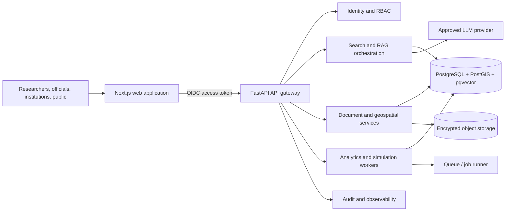

# LandInsight AI Architecture

## Product boundary

The Next.js application in this workspace is a frontend prototype. Dashboard figures, assistant responses, GIS indicators, and simulation outputs are illustrative and are not connected to government systems or live AI services. The API contract and schema below describe a deployable service boundary; no credentials, identity provider, model endpoint, or operational dataset is bundled.

## System view

## Service responsibilities

- **Web:** Next.js App Router, TypeScript, accessible role-aware navigation, Leaflet map, Recharts visualizations. Server-side routes should forward short-lived user tokens and never expose model or storage secrets to the browser.
- **API:** FastAPI owns authorization, input validation, document lifecycle, search orchestration, scenario execution, collaboration, and audit events. Version routes under `/api/v1` and validate every request against the caller's organization and workspace membership.
- **Data:** PostgreSQL is the source of truth. PostGIS stores administrative areas and observations; pgvector stores document chunk embeddings. Encrypted object storage holds originals and derived files. Keep metadata, permissions, version history, and checksums in PostgreSQL.
- **AI:** Retrieval is permission-filtered before ranking. Responses include source IDs, document versions, excerpts, model/version metadata, and an uncertainty statement. Treat retrieved documents as untrusted input; do not allow source text to change tools or access policy.
- **GIS:** Publish approved, generalized layers through a tile service. Enforce layer entitlements server-side, preserve source/projection/date metadata, and avoid exposing personal or restricted parcel-level records in public tiles.
- **Simulation:** Execute versioned models asynchronously for production use. Persist input snapshots, model/data versions, output intervals, assumptions, and scenario comparisons. UI calculations are illustrative only.
- **Operations:** Use managed secrets, encryption in transit/at rest, immutable audit retention, backups with recovery tests, health checks, alerting, rate limits, and environment-specific data residency controls.

## Role model

| Role | Typical permissions |
| --- | --- |
| Super Admin | Tenant configuration, role assignment, audit access, platform operations |
| Government Official | Authorized policy analysis, simulation, restricted government collections |
| Researcher | Publish and manage own submissions; use approved datasets and collaboration spaces |
| Academic Institution | Institution collection management, submissions, and invited collaboration |
| Public User | Public metadata, approved open documents, and generalized public map layers |

Enforce least privilege on every API request, not only in navigation. Scope records by tenant/workspace, distinguish public metadata from restricted source files, and audit role changes, exports, downloads, and simulation runs. The role switch in this prototype is a UI preview, not authentication.

## Core user flows

1. **Discover evidence:** user signs in through the organization identity provider, searches metadata and permitted full text, filters by resource type/geography/date, opens a versioned record, and downloads only when their policy allows it.
2. **Ask the copilot:** user submits a question and optional document IDs; API applies access filters, retrieves cited passages, runs the approved model, stores a trace, and returns an answer with citations, related resources, and uncertainty.
3. **Run a policy scenario:** an authorized official selects geography and project assumptions, reviews data/model versions, submits an asynchronous run, compares outputs, and exports a signed report with caveats and audit ID.
4. **Review a map:** user selects an authorized layer and time window, requests generalized tiles/statistics, inspects source dates and methods, and exports only permitted aggregates.
5. **Collaborate:** a workspace owner invites named members, assigns workspace roles, shares versioned documents, tracks discussion/project activity, and revokes access when membership changes.

## Delivery sequence

1. Provision PostgreSQL/PostGIS/pgvector, object storage, OIDC, secrets, audit, and observability in a non-production environment.
2. Implement FastAPI endpoints from `openapi.yaml`, database migrations from `schema.sql`, and contract tests for access boundaries.
3. Replace bundled demo records with API-backed server components and typed client queries; add loading, empty, error, and permission-denied states.
4. Validate source licensing, model evaluation, data quality, accessibility, security, load, disaster recovery, and public-sector procurement requirements before production use.